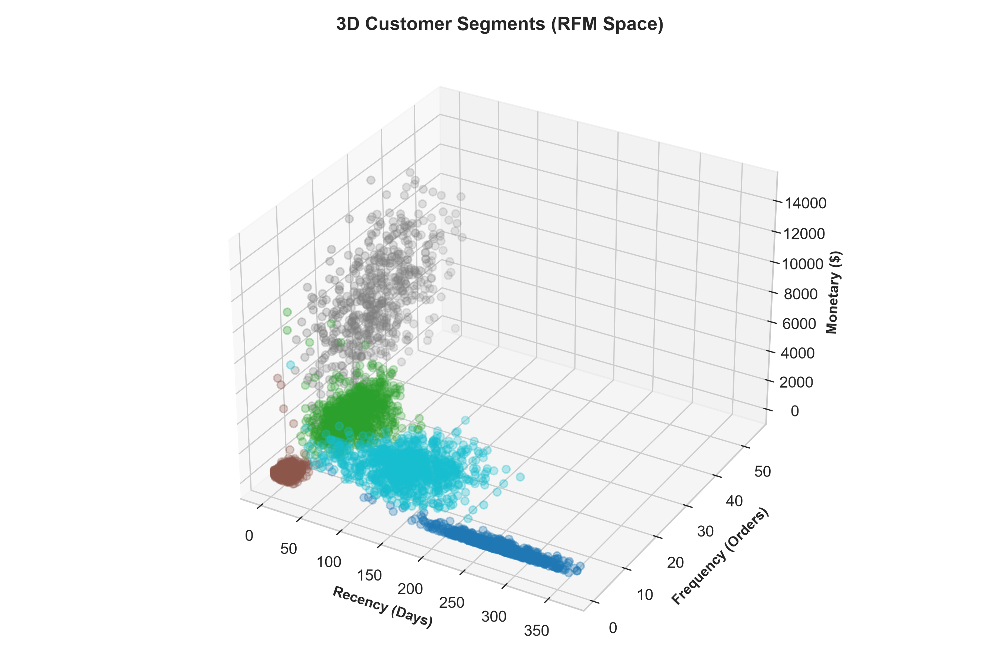
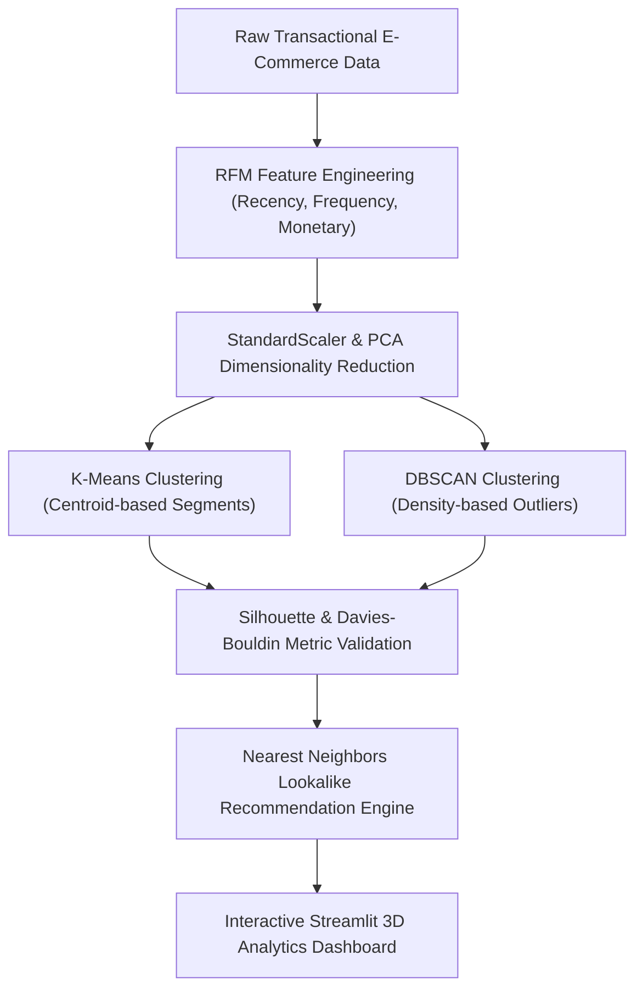

# ⚡ MarketMatch-AI: Enterprise E-Commerce Customer Analytics & Lookalike Studio

[](https://github.com/OxDurgeshxO/MarketMatch-AI/actions)
[](https://www.python.org/)
[](https://opensource.org/licenses/MIT)


[](https://oxdurgeshxo-marketmatch-ai-app-y8ysbm.streamlit.app/)


> **An Enterprise Customer Intelligence & Lookalike Recommendation Platform combining log-scaled RFM feature engineering, K-Means clustering, Gaussian Mixture Models (GMM), DBSCAN anomaly detection, and 1-click audience campaign exporting.**

---

## 🌐 Live Interactive Studio
👉 **[Open MarketMatch-AI Dashboard](https://oxdurgeshxo-marketmatch-ai-app-y8ysbm.streamlit.app/)**

<p align="center">
  
</p>

---

## 📌 Executive Overview

Modern retail organizations cannot rely on one-size-fits-all marketing. **MarketMatch-AI** transforms customer purchase histories into targeted audience segments:
- **RFM Metric Engineering**: Synthesizes transaction recency, purchase frequency, and monetary customer lifetime value into log-standardized behavioral spaces.
- **Multi-Model Unsupervised Suite**:
  - **K-Means Clustering**: Automated Elbow inertia and Silhouette score optimization ($K = 5$).
  - **Gaussian Mixture Models (GMM)**: Soft probabilistic clustering providing exact assignment confidence percentages.
  - **DBSCAN**: Outlier and anomaly detection for high-spending whales and non-standard profiles.
- **1-Click Lookalike Campaign Exporter**: Generates custom audience CSVs formatted for Meta Ads, Google Ads Customer Match, and Klaviyo email campaigns.
- **Segment Financial ROI Simulator**: Models customer cohort size, marketing campaign spend, and preserved Customer Lifetime Value (CLV) to compute net return before budget deployment.

---

## 🏗️ Architecture & Pipeline Flow

```
     4,000 E-Commerce Customer Records
                     │
                     ▼
┌─────────────────────────────────────────┐
│     RFM Feature Transformation Engine   │
│  np.log1p (Recency, Frequency, Spend)   │
│            + StandardScaler             │
└────────────────────┬────────────────────┘
                     │
                     ▼
┌─────────────────────────────────────────┐
│       Unsupervised ML Suite             │
│   • K-Means Cluster Optimization (K=5)  │
│   • Gaussian Mixture Models (GMM Soft)  │
│   • DBSCAN Spatial Anomaly Detection    │
│   • k-NN Cosine Similarity Engine       │
└────────────────────┬────────────────────┘
                     │
                     ▼
┌─────────────────────────────────────────┐
│   Serialized Artifacts & Diagnostics    │
│   .joblib Pipelines + Plotly Dashboards │
└────────────────────┬────────────────────┘
                     │
                     ▼
┌─────────────────────────────────────────────────────────────┐
│                 Streamlit Enterprise Studio                 │
│  [1] 3D Interactive Plotly Cluster Visualizer               │
│  [2] Lookalike Profiler & 1-Click Audience CSV Exporter     │
│  [3] Segment Revenue Share & Marketing ROI Simulator        │
│  [4] Quantitative Diagnostics (Elbow, Silhouette, GMM BIC)  │
└─────────────────────────────────────────────────────────────┘
```

---

## 🏷️ Customer Personas & Marketing Playbooks

| Segment Persona | Recency | Frequency | Annual Spend | Strategic Marketing Playbook |
| :--- | :---: | :---: | :---: | :--- |
| **👑 Champions (Whales)** | $\le 15$ days | $\ge 25$ orders | $\$6,000+$ | VIP concierge, early collection access, exclusive perks |
| **⭐ Loyal Regulars** | $30 - 60$ days | $10 - 20$ orders | $\$2,000 - \$4,000$ | Loyalty rewards, subscription tiers, product bundles |
| **🌱 Potential Loyalists** | $\le 20$ days | $1 - 4$ orders | $\$300 - \$800$ | Welcome email sequence, category onboarding discounts |
| **⚠️ At-Risk Customers** | $90 - 180$ days | $6 - 15$ orders | $\$1,200 - \$3,000$ | Reactivation coupons, personalized win-back outreach |
| **💤 Hibernating / Lost** | $\ge 200$ days | $1 - 2$ orders | $\le \$200$ | Clearance announcements, low-cost re-engagement surveys |

---

## 🚀 Quickstart & Local Setup

### 1. Clone the Repository
```bash
git clone https://github.com/OxDurgeshxO/MarketMatch-AI.git
cd MarketMatch-AI
```

### 2. Setup Virtual Environment & Dependencies
```bash
python -m venv .venv

# On Windows
.\.venv\Scripts\activate
# On macOS/Linux
source .venv/bin/activate

pip install -r requirements.txt
```

### 3. Run Pipeline & Launch Studio
```bash
# Execute segmentation pipeline and serialize models
python mall_customers_pipeline.py

# Launch interactive Streamlit application
streamlit run app.py
```

---

## 📂 Repository Structure

```
MarketMatch-AI/
├── data/
│   ├── ecommerce_rfm_customers.csv       # 4,000-record e-commerce dataset
│   └── mall_customers_legacy.csv         # Cleaned legacy 200-row benchmark
├── app.py                                # Streamlit Enterprise Cockpit (4 Tabs)
├── mall_customers_pipeline.py            # Complete unsupervised ML pipeline
├── models/
│   ├── kmeans_rfm_pipeline.joblib        # Fitted K-Means model
│   ├── gmm_rfm_model.joblib              # Fitted Gaussian Mixture Model
│   ├── nn_lookalike_model.joblib         # Nearest Neighbors lookalike engine
│   ├── scaler_rfm.joblib                 # Feature scaling pipeline
│   └── segment_metadata.json             # Segment summary metadata
├── outputs/
│   ├── MarketMatch_Dashboard.html        # Standalone portable Plotly dashboard
│   ├── RFM_Customer_Segments_3D.png      # 3D cluster visualization
│   ├── Elbow_Method.png                  # Inertia curve
│   ├── Silhouette_Score.png              # Silhouette coefficient curve
│   ├── DBSCAN_Clusters.png               # Spatial density clusters
│   └── Ecommerce_Customers_Segmented.csv # Fully labeled dataset export
├── requirements.txt                      # Project dependencies
└── README.md                             # Documentation
```

---

## 👤 Author
**Durgesh**  
GitHub: [@OxDurgeshxO](https://github.com/OxDurgeshxO)


## 🧠 Machine Learning Pipeline Architecture


